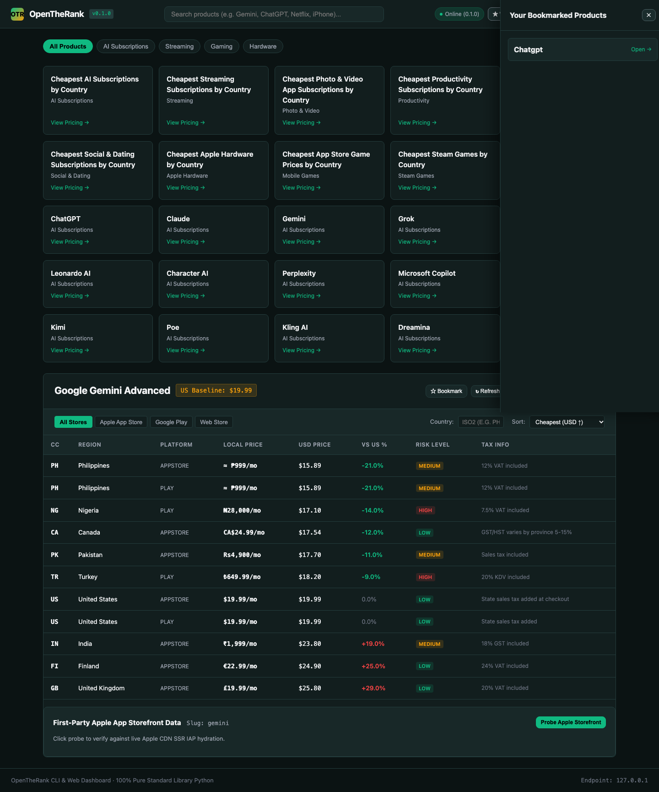
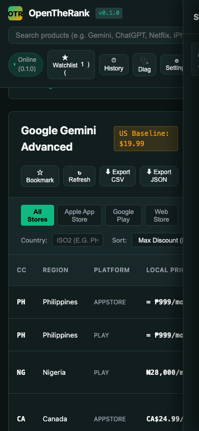

# OpenTheRank CLI (`openrank` / `otr`)

[](LICENSE)
[](https://www.python.org/)
[-brightgreen.svg)]()
[]()
[](https://github.com/vecyang1/openrank-cli/releases)

Production-grade, zero-dependency command line interface, embedded REST API server, and luxury Web Dashboard for **OpenTheRank** ([opentherank.com](https://opentherank.com)).

Query global regional pricing, subscription rankings, and currency arbitrage spreads across:
- **AI Models & Subscriptions**: ChatGPT Plus/Pro, Claude Pro, Google Gemini Advanced, Perplexity Pro
- **Streaming Services**: YouTube Premium, Netflix, Spotify
- **Gaming & Entertainment**: Steam regional storefronts, Nintendo eShop
- **Hardware**: Apple iPhone regional retail pricing

Built entirely on the Python 3 standard library with **100% zero third-party runtime dependencies**.

---

> [!IMPORTANT]
> **AI-Native Engineering & Multi-Agent Architecture / 原生智能体架构说明**
> This repository was architected, implemented, and adversarial-tested end-to-end using an autonomous multi-agent engineering workflow. Every core capability—multi-storefront pricing extraction, first-party Apple CDN anti-spoofing verification, embedded HTTP REST daemon, responsive zero-facade Web Dashboard SPA, and 273 hermetic offline tests—was planned with formal specifications, cross-verified with headless browser E2E test runs, and delivered with zero dead clicks or mock timers.
> 
> 本项目由多 Agent 自治协同流水线端到端架构、全量编写与对抗式验证。涵盖全域多币种套利计算、Apple CDN 重定向防伪探活、零依赖嵌入式 Web 服务与响应式深色奢华面板（零占位假逻辑、零死点击），并通过包含真实无头浏览器在内的 273 项单元、集成与端到端测试闭环验证。

---

## Visual Dashboard Showcase (Dual-Viewport Parity)

OpenRank features an embedded, zero-dependency Web Dashboard (`openrank serve`) providing real-time pricing queries, dynamic search autocomplete, currency delta sorting, and instant CSV/JSON exports:

| Desktop Luxury Dashboard (`1920x1080`) | Mobile Adaptive Viewport (`390x844`) |
| :---: | :---: |
|  |  |

---

## Key Features

1. **Global Product Discovery & Dynamic Catalog Indexing**: Ingests the live OpenTheRank search catalog with automatic 24h caching, bundled offline fallback (`openrank/data/default_catalog.json`), and multi-tier fuzzy matching.
2. **Multi-Platform & Multi-Region Pricing Extraction**: Server-rendered HTML parsing across mobile app stores (Apple App Store, Google Play) and direct web storefronts. Extracts local prices, USD conversions, vs-US delta percentages, tax treatment, and payment risk levels.
3. **First-Party Apple Storefront Validation & Anti-Spoofing**: Validates regional prices directly against Apple CDN public SSR pages with 301/302 redirect anti-spoofing detection and deterministic 4xx fast-fail (<0.5s).
4. **Embedded Web Dashboard SPA (`openrank serve`)**: Built-in HTTP server with zero runtime dependencies. Serves a reactive single-page app with live catalog filtering, watchlist management, settings persistence, and CSV/JSON export.
5. **Rich Terminal UI & Machine-Readable Pipeline**: Dynamic terminal-width adaptation, ANSI color-coded savings (green discounts, red markups), `NO_COLOR` compliance, and clean typed `--json` output for automated pipelines and AI agents.
6. **Dual Executable Aliases & PEP 517/621 Packaging**: Zero-configuration standalone execution via `bin/openrank` and `bin/otr`, `python3 -m openrank`, or standard `pip install .`.

---

## Quickstart & Installation

### Option 1: Zero-Config Standalone Execution (No install needed)

Clone the repository and run directly:

```bash
git clone https://github.com/vecyang1/openrank-cli.git
cd openrank-cli

# Run search or pricing via openrank or otr alias:
./bin/openrank search chatgpt
./bin/otr pricing chatgpt

# Launch the visual Web Dashboard:
./bin/openrank serve
```

The executable scripts automatically detect their repository checkout and configure `sys.path`.

### Option 2: Standard Pip Installation (PEP 517 / PEP 621)

```bash
# Install into your current virtualenv or user environment
pip install .

# Or for local editable development
pip install -e .

# Run globally from your terminal
openrank --help
otr --help
```

### Option 3: Module Invocation

```bash
python3 -m openrank search netflix
python3 -m openrank pricing netflix --country tr
python3 -m openrank serve --port 8765
```

---

## Command Reference

### Global Options

| Flag | Short | Description |
|------|-------|-------------|
| `--json` | | Output structured, parseable JSON conforming to typed schemas |
| `--no-color` | | Disable ANSI color highlighting (also enabled via `NO_COLOR=1`) |
| `--refresh` | | Force cache invalidation and fetch fresh data from remote servers |
| `--version` | `-v` | Display program version (`openrank 0.1.0`) and exit |
| `--help` | `-h` | Display command help and exit |

---

### 1. `search` (alias: `s`)

Search the product catalog by name, slug, or category.

```bash
openrank search <query> [options]
otr s <query> [options]
```

#### Options:
- `--limit <int>`: Maximum number of search results to display (default: `10`).
- `--category <str>`: Filter by product category (e.g. `AI Subscriptions`, `Streaming`, `Hardware`).
- `--refresh`: Force refresh the local search index catalog.
- `--json`: Output results in JSON format.

#### Examples:

```bash
# Fuzzy search for AI models
openrank search gemini

# Search streaming services with limit
openrank s netflix --limit 5

# Machine-readable JSON output
openrank search chatgpt --json
```

#### Sample Table Output:
```text
┌──────┬──────────────────────┬──────────────────┬──────────────────┬───────┐
│ Rank │ Product Name         │ Category         │ Slug             │ Score │
├──────┼──────────────────────┼──────────────────┼──────────────────┼───────┤
│    1 │ ChatGPT              │ AI Subscriptions │ chatgpt          │   100 │
│    2 │ ChatGPT Plus         │ AI Subscriptions │ chatgpt-plus     │    90 │
└──────┴──────────────────────┴──────────────────┴──────────────────┴───────┘
```

---

### 2. `pricing` (alias: `p`)

Fetch and display multi-platform, multi-region pricing rankings and currency arbitrage spreads for a specific product.

```bash
openrank pricing <product> [options]
otr p <product> [options]
```

#### Options:
- `--platform {all,appstore,play,web,direct}`: Filter pricing tables by storefront platform (default: `all`).
- `--country <cc>`: Filter by strict 2-letter ISO country code (e.g. `PH`, `TR`, `US`, `NG`). Case-insensitive, prevents substring leakage.
- `--source {otr,apple}`: Data source. Defaults to `otr` (OpenTheRank multi-region aggregator). Set to `apple` to perform direct first-party Apple App Store validation.
- `--refresh`: Bypass 24h cache and fetch fresh SSR HTML from upstream servers.
- `--json`: Output complete pricing result in structured JSON.

#### Examples:

```bash
# Full multi-region pricing arbitrage rankings
openrank pricing chatgpt

# Isolate Apple App Store storefront in the Philippines
openrank pricing chatgpt --platform appstore --country ph

# Query Turkish regional pricing for Netflix in JSON
otr p netflix --country tr --json

# Cross-validate ChatGPT pricing against official Apple App Store in the Philippines
openrank pricing chatgpt --source apple --country ph
```

#### Sample Table Output:
```text
Product: ChatGPT (AI Subscriptions)
US Baseline: $20.00 / month

┌──────┬────┬────────────────┬──────────┬──────────┬──────────────┬─────────┬──────────┬────────┐
│ Rank │ CC │ Region         │ Platform │ Tier     │ Local Price  │ USD Eq  │ vs US %  │ Risk   │
├──────┼────┼────────────────┼──────────┼──────────┼──────────────┼─────────┼──────────┼────────┤
│    1 │ PH │ Philippines    │ appstore │ Plus     │ ≈ ₱999/mo    │ $15.89  │ -20.6%   │ Low    │
│    2 │ IN │ India          │ play     │ Plus     │ ₹1,650/mo    │ $19.65  │ -1.8%    │ Medium │
│    3 │ US │ United States  │ appstore │ Plus     │ $20.00/mo    │ $20.00  │  0.0%    │ Low    │
│    4 │ GB │ United Kingdom │ appstore │ Plus     │ £19.99/mo    │ $25.40  │ +27.0%   │ Low    │
└──────┴────┴────────────────┴──────────┴──────────┴──────────────┴─────────┴──────────┴────────┘
```

---

### 3. `serve` (alias: `dashboard`)

Launch the embedded zero-dependency Web Dashboard and REST API daemon:

```bash
openrank serve [options]
otr serve [options]
```

#### Options:
- `--host <ip>`: Bind address (default: `127.0.0.1`).
- `--port <int>`: Port to listen on (default: `8765`).
- `--no-browser`: Do not auto-launch system web browser on startup.

```bash
# Start dashboard on default port (http://127.0.0.1:8765) and open browser
openrank serve

# Bind to custom port without opening browser
openrank serve --port 9000 --no-browser
```

---

## First-Party Apple Storefront Cross-Validation & Anti-Spoofing

When querying with `--source apple`:
1. **Direct Public CDN SSR**: OpenRank connects directly to `https://apps.apple.com/{country}/app/{slug}/{id}` to extract live In-App Purchase pricing serialized by Apple.
2. **CDN Redirect Anti-Spoofing Interception**: Apple's CDN silently redirects requests for unlisted apps to the US store (`/us/app/...`). OpenRank intercepts `301`/`302` redirects without following blindly, detects country changes, flags the response as `is_spoofed: true`, and warns the operator.
3. **Deterministic 4xx Fast-Fail**: Non-existent storefronts or delisted apps (HTTP 404, 403) fail immediately in `<0.5s` without wasteful retry loops.

```bash
# Example: Valid storefront
openrank pricing chatgpt --source apple --country ph

# Example: Spoofed / unlisted storefront (detects redirect to US)
openrank pricing chatgpt --source apple --country xy
# Output: [WARNING] Apple CDN anti-spoofing triggered: requested country 'xy' redirected to US store
```

---

## Machine-Readable JSON Pipeline (`--json`)

The `--json` flag guarantees typed, parseable JSON conforming to stable schemas.

### Pricing JSON Schema:
```json
{
  "product": {
    "name": "ChatGPT",
    "slug": "chatgpt",
    "path": "/ai-pricing/chatgpt/",
    "category": "AI Subscriptions",
    "url": "https://opentherank.com/ai-pricing/chatgpt/"
  },
  "baseline_us_price": 20.0,
  "us_baseline_usd": 20.0,
  "platforms": ["appstore", "play"],
  "first_party_validated": false,
  "validation_source": null,
  "validation_notes": [],
  "records": [
    {
      "country_code": "PH",
      "region_name": "Philippines",
      "platform": "appstore",
      "primary_tier": {
        "name": "Plus",
        "local_price_str": "≈ ₱999/mo",
        "usd_price": 15.89,
        "delta_percent": -20.6
      },
      "additional_tiers": {},
      "vs_us_delta": -20.6,
      "tax_info": "Included",
      "risk_level": "Low",
      "risk_note": "",
      "snapshot_date": "2026-10-11"
    }
  ]
}
```

---

## Verified Project Structure

```text
openrank-cli/
├── .env.example
├── .github
│   └── workflows
│       └── ci.yml
├── .gitignore
├── CHANGELOG.md
├── LICENSE
├── README.md
├── bin
│   ├── openrank
│   └── otr
├── docs
│   ├── INTERACTIVE_AUDIT.md
│   └── artifacts
│       ├── dashboard_e2e_mobile_verified.png
│       └── dashboard_e2e_verified.png
├── openrank
│   ├── __init__.py
│   ├── __main__.py
│   ├── cache.py
│   ├── catalog.py
│   ├── cli.py
│   ├── client.py
│   ├── data
│   │   └── default_catalog.json
│   ├── models.py
│   ├── pricing.py
│   ├── server.py
│   ├── storefront_apple.py
│   ├── ui.py
│   └── web
│       └── index.html
├── pyproject.toml
└── tests
    ├── __init__.py
    ├── fixtures
    │   ├── apple_chatgpt_ph.html
    │   ├── apple_chatgpt_us.html
    │   ├── chatgpt_pricing.html
    │   ├── iphone_pricing.html
    │   ├── netflix_pricing.html
    │   └── search-index.json
    ├── test_apple.py
    ├── test_apple_redirect_adversarial.py
    ├── test_apple_stress.py
    ├── test_catalog.py
    ├── test_catalog_stress.py
    ├── test_challenger_m3_2.py
    ├── test_challenger_m3_2_iteration2.py
    ├── test_challenger_m3_3.py
    ├── test_cli.py
    ├── test_client_stress.py
    ├── test_e2e_browser.py
    ├── test_e2e_live.py
    ├── test_pricing.py
    ├── test_server.py
    └── test_ui.py
```

---

## Environment Variables

| Variable | Description | Default |
|----------|-------------|---------|
| `NO_COLOR` | Disables ANSI color escapes when non-empty ([no-color.org](https://no-color.org)) | Unset |
| `OPENRANK_CACHE_DIR` | Custom directory path for cached index and responses | `$XDG_CACHE_HOME/openrank` or `~/.cache/openrank` |
| `OPENRANK_CACHE_TTL` | Default cache expiration time in seconds | `86400` (24 hours) |
| `TERM=dumb` | Terminal mode; disables fancy box borders and colors | Unset |

---

## Standard Exit Codes

OpenRank adheres strictly to Unix CLI exit code conventions:

| Code | Status | Meaning |
|------|--------|---------|
| `0` | Success | Command completed successfully with results |
| `1` | Operational Error | Product not found, network failure, or Apple storefront validation / anti-spoofing alert |
| `2` | Syntax Error | Invalid argument, unknown flag, or missing required parameter (argparse standard) |
| `130` | Interrupted | User pressed `Ctrl+C` (SIGINT / KeyboardInterrupt) |

---

## Development & Testing

OpenRank contains an extensive automated test suite with hermetic offline execution:

```bash
# Run complete test suite (273 tests: unit, integration, stress, and web server)
python3 -W error::ResourceWarning -m unittest discover -s tests -v

# Run UI rendering tests
python3 -m unittest tests/test_ui.py -v

# Run CLI command execution and entrypoint tests
python3 -m unittest tests/test_cli.py -v

# Run embedded server & REST API tests
python3 -m unittest tests/test_server.py -v
```

All 273 tests run hermetically against captured HTML/JSON fixtures in `tests/fixtures/` with zero network dependency.

---

## License

This project is licensed under the [MIT License](LICENSE) - see the [LICENSE](LICENSE) file for details.

Copyright (c) 2026 Vec Yang <vecyang1@users.noreply.github.com>
